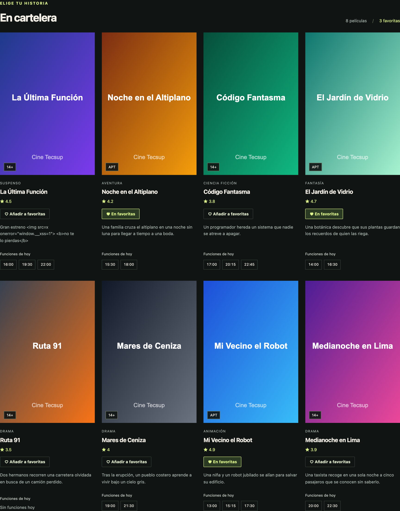
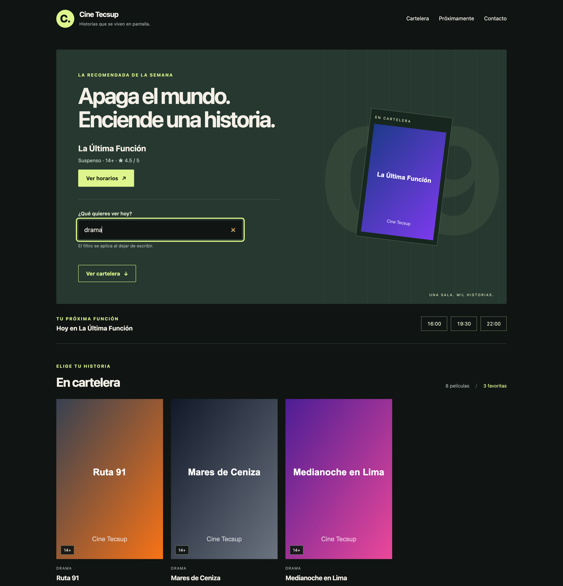
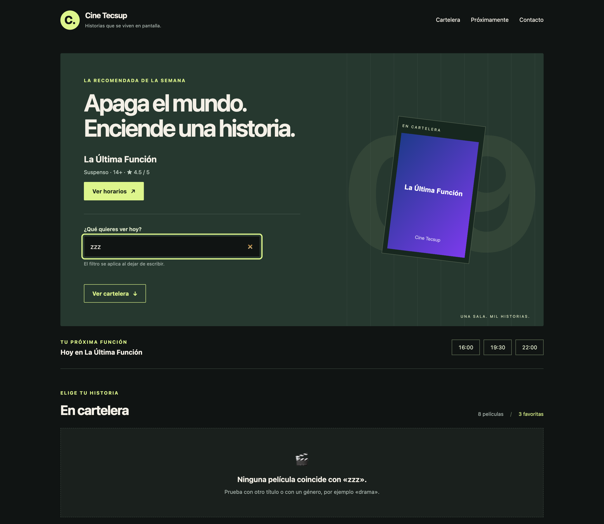
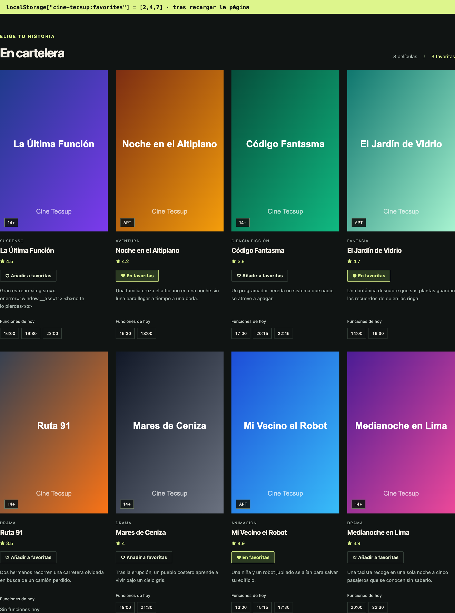
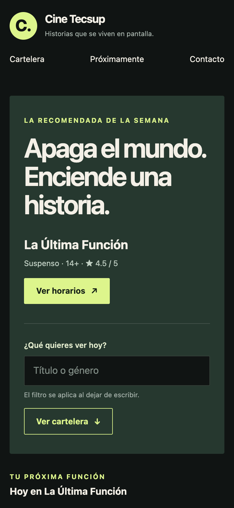
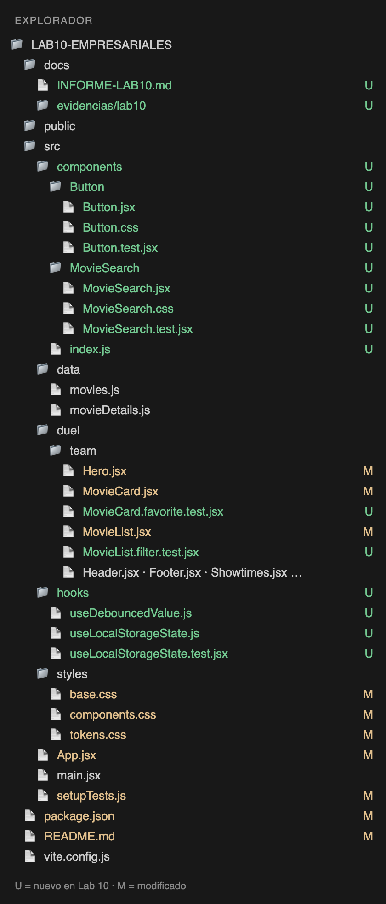

# Laboratorio 10 · Componentes y eventos

**Guillermo Willard** · Desarrollo de Aplicaciones Empresariales · Semana 10
Repositorio: https://github.com/willardguillermo/lab10-empresariales

## Resumen

Sobre la cartelera del laboratorio 9 se añadieron un componente `Button` reutilizable, películas favoritas con `useState`, un buscador controlado con retardo integrado en el banner, filtrado con estado vacío y persistencia de favoritas en `localStorage`. Cada paso de la guía está en un commit propio. Resultado: 61 pruebas en verde (`npm test`) y compilación de producción correcta (`npm run build`).

| Paso | Commit |
| --- | --- |
| 1. Partir del Lab 9 | `chore: partir de la cartelera del laboratorio 9…` |
| 2. Estilos de formulario, tipografía y utilidades | `style: ampliar la hoja base…` |
| 3. Button con `children` y `variant` | `feat: crear componente Button reutilizable…` |
| 4. Estado de favoritas en App | `feat: agregar estado de favoritas en App…` |
| 5. Botón de favorita en MovieCard | `feat: pasar toggleFavorite a MovieCard…` |
| 6. MovieSearch como entrada controlada | `feat: crear MovieSearch como entrada controlada` |
| 7. Retardo del buscador | `feat: agregar retardo al buscador…` |
| 8. Filtrado y estado vacío | `feat: filtrar la cartelera por el buscador…` |
| 9. Buscador en el banner | `feat: integrar el buscador en el banner…` |
| 10. Favoritas en localStorage | `feat: guardar las favoritas en localStorage…` |

## Componentes reutilizables

- **Button** (`src/components/Button`): recibe el contenido por `children` y el aspecto por `variant` (`primary`, `secondary`, `ghost`) y `size` (`md`, `sm`). Con `href` dibuja un enlace con aspecto de botón (navegación); sin él, un `<button>` real (acción). El mismo componente se usa en tres sitios cambiando solo props: «Ver horarios» (primary, enlace), «Ver cartelera» (secondary, enlace) y el botón de favorita de cada tarjeta (ghost, sm, con `aria-pressed`).
- **MovieSearch** (`src/components/MovieSearch`): no sabe nada de películas; solo avisa al padre con `onSearch(texto)`. Su etiqueta, placeholder y retardo son props, así que sirve para cualquier buscador.
- **Hero** ahora acepta `children`: App le inserta el buscador y la llamada a la acción sin que Hero dependa de ellos.
- Hooks propios: `useDebouncedValue` (retardo) y `useLocalStorageState` (estado persistente).

## Qué recuerda la aplicación y dónde se decidió guardarlo

| Dato | Dónde vive | Por qué |
| --- | --- | --- |
| Texto que se escribe (`text`) | Estado local de `MovieSearch` | Solo el input lo necesita en cada pulsación; subirlo a App re-renderizaría toda la página por cada letra. |
| Texto del filtro aplicado (`query`) | Estado de `App` | Lo escribe `MovieSearch` y lo lee `MovieList`, que son hermanos: el estado se eleva al padre común. Llega a App ya con retardo (400 ms). |
| Películas favoritas (`favoriteIds`) | Estado de `App`, guardado en `localStorage` (`cine-tecsup:favorites`) | Lo modifican las tarjetas y lo usa el contador del encabezado. Solo se guardan los ids; los datos de la película ya existen. Se valida al leer (lista de enteros) para ignorar valores corruptos. |
| Si una tarjeta es favorita (`isFavorite`) | No es estado: prop calculada en `MovieList` | Se deriva de `favoriteIds`; duplicarlo en la tarjeta rompería la fuente única de verdad. |
| Películas visibles tras filtrar | No es estado: se calcula en `MovieList` en cada render | Es un dato derivado de `movies` y `query`. |

Comunicación hacia arriba: `MovieCard` no modifica el estado de App; solo llama a `onToggleFavorite(movie.id)` y App decide con `setFavoriteIds`. Igual con `MovieSearch → onSearch`.

## Retardo comprobado en la consola

Al escribir «drama» hay 5 pulsaciones, pero el filtro se aplica una sola vez, unos 400 ms después de la última tecla (`docs/evidencias/lab10/04-consola-retardo.txt`):

```text
debug  [MovieSearch] pulsación: "d"
debug  [MovieSearch] pulsación: "dr"
debug  [MovieSearch] pulsación: "dra"
debug  [MovieSearch] pulsación: "dram"
debug  [MovieSearch] pulsación: "drama"
info   [MovieSearch] filtro aplicado: "drama"
```

## Casos de prueba

| Caso | Resultado esperado | Estado |
| --- | --- | --- |
| Button con variante desconocida | Usa `primary` | ✔ |
| Button con `href` | Dibuja un enlace | ✔ |
| Clic en «Añadir a favoritas» | Llama a `onToggleFavorite(id)` y el botón pasa a «En favoritas» | ✔ |
| Escribir «rob» rápido | El input muestra «rob»; `onSearch` se llama 1 vez tras 400 ms | ✔ |
| Buscar «CODIGO» | Encuentra «Código Fantasma» (sin mayúsculas ni tildes) | ✔ |
| Buscar «zzz» | Estado vacío «Ninguna película coincide con «zzz».» | ✔ |
| Recargar la página | Las favoritas siguen marcadas | ✔ |
| `localStorage` corrupto | Arranca sin favoritas, sin romperse | ✔ |

## Evidencias








