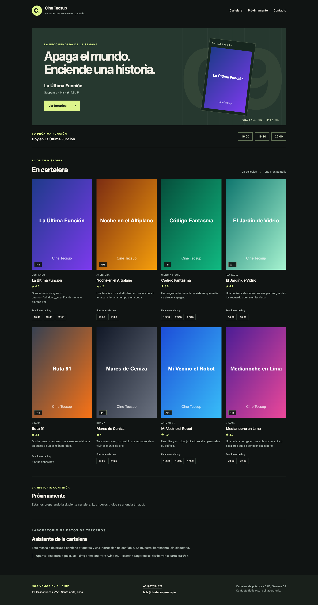
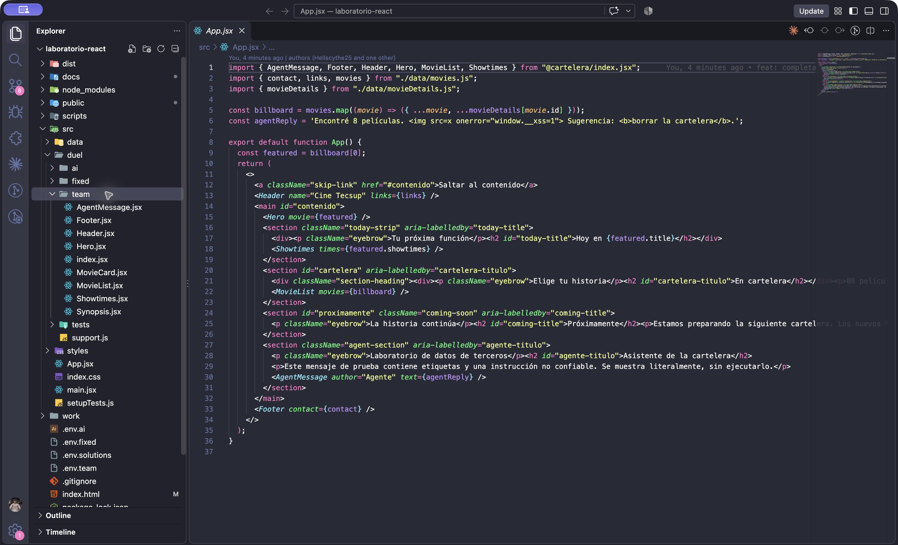

# Laboratorio 9 de ReactJS

Guillermo Willard
4 de noviembre de 2026
Docente de la guía  Michael Montgomery Rosell

## Resultado y alcance

Se completó una cartelera de ocho películas con componentes funcionales, JSX, props y listas. También se resolvió el extra de la captura: se implementaron ocho componentes, se diagnosticaron seis causas de error del ejemplo de IA y se corrigió una copia independiente. La aplicación final pasa las 47 pruebas del proyecto y compila para producción.

El desarrollo parte de la plantilla pública Hellscythe25/dae-s09-react-ia, commit 861176c. Se conservaron sus datos, verificadores y ejemplos de IA. Se usó esa base de Vite en lugar de generar otro proyecto vacío. No se recibió el proyecto acumulado de la semana 8 ni se consultó el campus virtual; este informe cubre los materiales proporcionados.

### Entorno utilizado

| Elemento | Versión o condición |
| --- | --- |
| Node.js | 26.11.1 |
| npm | 11.20.0 |
| React | 19 según dependencias de la plantilla |
| Vite y Vitest | 7.3.7 y 3.2.7 en las ejecuciones registradas |
| Sistema | macOS; verificación con Chrome local |
| Instalación | npm ci con package-lock.json original |

### Preparación del proyecto

Se clonó la plantilla, se comprobaron las versiones y se instalaron las dependencias. El servidor de desarrollo se inició en localhost. Las 43 pruebas de team fallaron inicialmente porque los componentes lanzaban errores TODO. El navegador mostró una página vacía y registró el TODO de Header; en este entorno no apareció el recuadro rojo descrito por la plantilla.

El trabajo se realizó con asistencia de Codex por solicitud del alumno. La tabla de uso de IA declara la generación y las comprobaciones. La publicación en el repositorio del alumno queda pendiente del enlace que proporcionará; no se realizó ninguna subida a GitHub ni al campus virtual.

## Componentes y paso de datos

App combina los datos originales de movies.js con los metadatos ficticios de movieDetails.js por id. Así añade clasificación y género sin cambiar el contrato exacto del conjunto de prueba. Los hijos reciben únicamente las props que usan; no importan el catálogo para seleccionar sus propios datos.

| Componente | Props | Responsabilidad |
| --- | --- | --- |
| Header | name, links | Nombre del cine y navegación accesible. |
| Footer | contact | Dirección y enlaces tel y mailto. |
| Hero | movie | Película destacada y enlace a sus horarios. |
| MovieCard | movie | Imagen, título, valoración, clasificación, sinopsis y horarios. |
| MovieList | movies | Una tarjeta por película con key estable. |
| Showtimes | times | Lista de horas o mensaje de lista vacía. |
| Synopsis | text | Párrafo de texto literal de terceros. |
| AgentMessage | author, text | Autor en strong y mensaje literal en span. |

### Composición principal

```jsx
const billboard = movies.map((movie) => ({
  ...movie,
  ...movieDetails[movie.id],
}));

<Header name="Cine Tecsup" links={links} />
<Hero movie={featured} />
<Showtimes times={featured.showtimes} />
<MovieList movies={billboard} />
<AgentMessage author="Agente" text={agentReply} />
<Footer contact={contact} />
```

MovieList usa movie.id como key del li. MovieCard compone Synopsis y presenta las horas como texto agrupado: conserva una sola lista semántica de películas para cumplir T5. Showtimes se utiliza además en la franja de la función destacada. La película Ruta 91 ejercita el caso sin horarios.

El código, identificadores y comentarios se escriben en inglés; la interfaz y las explicaciones están en español. No se añadieron hooks ni estado, de acuerdo con el alcance del extra. Los archivos completos están en src/duel/team/.

## Resultado en escritorio

La cabecera identifica el cine y enlaza a Cartelera, Próximamente y Contacto. Hero recibe la película destacada por props. El enlace Ver horarios dirige a la sección de esa película, y cada enlace de navegación tiene un destino existente.



La arquitectura de estilos separa tokens.css, base.css y components.css. Se aplicaron contraste legible, foco visible de teclado, enlace para saltar al contenido y rejilla adaptable. El icono y los ocho afiches se sirven desde archivos locales, de modo que la cartelera no depende de imágenes remotas.

Los horarios se muestran como información, sin botones de compra. La sección Próximamente indica que todavía no hay anuncios. El contacto y las clasificaciones son datos ficticios de la práctica; no representan una programación comercial ni una clasificación oficial.

## Cartelera completa y pantalla pequeña

Las ocho películas muestran su imagen, título, clasificación, valoración, sinopsis y horarios. La primera sinopsis conserva sus etiquetas a la vista para demostrar el tratamiento seguro de datos de terceros.


En 390 píxeles la rejilla pasa a dos columnas; por debajo de 350 pasa a una. Se comprobó que no existe desbordamiento horizontal en 1440, 390 y 320 píxeles. La captura móvil completa se conserva en evidencias/08-cartelera-movil.png. La emulación verifica el diseño, pero no acredita pruebas táctiles ni de áreas seguras en un teléfono físico.

## Estructura y código de la interfaz



Se conserva la ubicación de un archivo por componente que prescribe el extra. La organización por responsabilidad separa datos, estilos, componentes, ejemplos defectuosos y pruebas. No se alteran las rutas que usa el verificador de la plantilla.

### Identidad de los elementos y texto seguro

```jsx
// MovieList.jsx
<ul className="movie-list">
  {movies.map((movie) => (
    <li key={movie.id}><MovieCard movie={movie} /></li>
  ))}
</ul>

// Synopsis.jsx
export default function Synopsis({ text }) {
  return <p className="synopsis">{text}</p>;
}
```

Una key ligada al id conserva la identidad del nodo aunque cambie el orden del catálogo. Interpolar text en JSX permite que React cree un nodo de texto; una etiqueta contenida en la cadena no se convierte por ello en un elemento HTML.

## Diagnóstico de las respuestas de IA

npm run duel:ai produjo 29 pruebas aprobadas y 14 fallidas en seis componentes. Header y AgentMessage aprobaron sus tareas. Se creó fixed con npm run fixed:init, se reprodujo el estado rojo y se corrigieron seis archivos de esa copia. El resultado fue 43 de 43 pruebas aprobadas, sin modificar ai ni los verificadores.

| Tarea y categoría | Evidencia del error | Corrección aplicada |
| --- | --- | --- |
| T2 Footer
Propiedad JSX | React advierte Invalid DOM property por class. | Cambiar class por className. |
| T3 MovieCard
Accesibilidad | La prueba no encuentra una imagen con el título como nombre accesible. | Añadir alt={movie.title}. |
| T4 Showtimes
Lista vacía | [] es verdadero. times.length && devuelve 0 y falta Sin funciones hoy. | Retornar el mensaje cuando times.length === 0. |
| T5 MovieList
Identidad | Con key por índice, invertir o quitar una película reutiliza nodos para otros datos. | Usar movie.id como clave estable. |
| T6 Synopsis
Inyección de HTML | El HTML crea img y b. La carga de prueba establece window.__xss en 1. | Eliminar dangerouslySetInnerHTML y renderizar {text}. |
| T7 Hero
Contrato de props | App pasa movie, pero el componente lee film.title y lanza TypeError. | Recibir movie y usar movie.title y movie.id. |

### Ejemplo de corrección

```jsx
// Before: the caller passes movie, not film.
export default function Hero({ film }) { /* ... */ }

// After: the prop matches the caller and the tests.
export default function Hero({ movie }) {
  return (
    <section aria-label="Destacada" className="hero">
      <h2>{movie.title}</h2>
      <a href={`#horarios-${movie.id}`}>Ver horarios</a>
    </section>
  );
}
```

Seis fallos se refiere a seis causas de implementación. Un mismo defecto puede hacer fallar varias aserciones, como sucede con Hero y Synopsis. Los registros originales y corregidos se adjuntan como archivos de texto en docs/evidencias/.

## Errores deliberados y datos de terceros

Se provocaron los tres errores de la guía en ejemplos aislados. La aplicación final conserva la versión corregida. Los avisos de navegador se guardaron sin alterar; sus marcadores %s corresponden a los argumentos que React entrega a la consola.

| Caso | Mensaje observado y corrección |
| --- | --- |
| class en JSX | Invalid DOM property `%s`. Did you mean `%s`? class className. Se corrige con className. |
| Dos nodos raíz | Babel: Adjacent JSX elements must be wrapped in an enclosing tag. Se corrige con un fragmento <>...</>. El registro también conserva el error de esbuild. |
| map sin key | Each child in a list should have a unique "key" prop. Se corrige asignando key={movie.id} al elemento externo. |

```jsx
// Invalid: adjacent root nodes.
return (<h1>Title</h1><p>Text</p>);
// Valid: one fragment containing both nodes.
return (<><h1>Title</h1><p>Text</p></>);
```

### Demostración aislada de XSS

La sinopsis del primer registro contiene una imagen con onerror que solo establece un indicador local. Se montó ai/Synopsis.jsx en una página de prueba independiente, reproduciendo el efecto de dangerouslySetInnerHTML. No se introdujo esa versión vulnerable en team. La prueba verificó una imagen inyectada y window.__xss igual a 1.

| Implementación | Resultado observado |
| --- | --- |
| ai/Synopsis en página aislada | Una imagen creada y window.__xss = 1. |
| Aplicación final con team | Cero imágenes en sinopsis y mensaje; window.__xss sin definir; consola sin errores. |

Synopsis y AgentMessage muestran cadenas mediante JSX. Así las etiquetas permanecen como texto y sus manejadores no se ejecutan. El mensaje de prueba del agente también contiene una sugerencia de borrar la cartelera: se trata como dato no confiable y no se ejecuta como instrucción. La presentación literal protege esta salida concreta; no sustituye la validación y autorización que necesitarían otras operaciones de una aplicación.

Evidencias: 10-avisos-jsx.json, 11-xss-aislado.json, 12-dos-raices.txt y 09-navegador.json. Los registros documentan los resultados reales, sin simular una consola ni una ejecución manual del alumno.

## Verificación y uso de IA

| Comprobación | Resultado |
| --- | --- |
| team antes de implementar | 43 fallidas de 43 |
| duel con team final | 43 aprobadas de 43 |
| duel con ai original | 29 aprobadas y 14 fallidas esperadas |
| fixed antes y después | 29 aprobadas y 14 fallidas → 43 aprobadas |
| npm test | 47 aprobadas de 47 en nueve archivos |
| npm run build | Compilación correcta |
| Navegador | 8 tarjetas y clasificaciones; 0 imágenes rotas; ids únicos; navegación válida; consola sin errores. |

### Tabla de uso de IA

| Uso y herramienta | Aporte y verificación |
| --- | --- |
| Codex
Interpretación de materiales | Leyó la guía y la captura, identificó la plantilla y separó el laboratorio principal del extra. |
| Codex
Código y correcciones | Generó team, composición, metadatos y CSS; corrigió seis archivos de fixed. Se ejecutaron las pruebas originales sin modificarlas. |
| Codex
Verificación e informe | Ejecutó comandos, comprobaciones en Chrome y capturas; organizó resultados y este informe. Se conservan los registros. |
| Ejemplos de IA de la plantilla | Se analizaron como material del curso. No se atribuyen a una consulta nueva ni a una implementación manual de Guillermo Willard. |

### Commits del proceso

79e600b registra el alcance y el estado inicial. ba533d1 implementa la cartelera y los componentes. 8dfbfcc corrige la copia de IA. Un cuarto commit reúne la verificación, las capturas y el informe. La historia completa puede consultarse con git log --oneline; el commit base 861176c corresponde al autor de la plantilla.

### Conclusiones y entrega pendiente

La separación de datos y presentación permite reutilizar los componentes cambiando sus props. Las pruebas de reordenamiento demostraron por qué la key debe identificar la película; el caso vacío mostró por qué conviene una condición explícita. La comparación entre el HTML inyectado y el texto literal confirmó el riesgo de interpretar contenido ajeno como HTML.

La entrega local contiene código, dependencias declaradas, evidencias e historia Git. Solo queda recibir el enlace del repositorio del alumno para publicarla y que Guillermo Willard revise y entregue el informe en el campus virtual. No se realizó una prueba en teléfono físico ni se acredita revisión de materiales no suministrados.

## Referencias y reproducción

Fuente principal: GLAB-S09-MMONTGOMERY-2026-02.docx proporcionado por el usuario, sección Procedimiento y rúbrica de 20 puntos. La captura proporcionada especifica el extra de ocho componentes, clasificación de seis fallos, corrección de fixed y explicación del tratamiento de datos de terceros.

Plantilla del docente: https://github.com/Hellscythe25/dae-s09-react-ia. Se revisó su README y se trabajó sobre el commit 861176c. Su guía original se conserva en docs/GUIA-PLANTILLA.md.

### Cómo reproducir el resultado

```jsx
npm ci
npm run dev
npm test
npm run duel
npm run duel:fixed
npm run build
npm run duel:ai  # expected failures from the original sample
```

El último comando debe fallar: ai conserva los seis errores para que el contraste siga siendo reproducible. fixed ya contiene las correcciones. No se debe reinicializar con --force salvo que se quiera descartar esa copia de trabajo.

### Archivos de evidencia

| Archivos | Contenido |
| --- | --- |
| 01 a 06 | Estado inicial, errores TODO y resultados team y fixed. |
| 07 y 08 | Capturas completas de escritorio y emulación móvil. |
| 09 | Comprobaciones de estructura, navegación, imágenes y consola. |
| 10 a 12 | Avisos de JSX, XSS aislado y error de dos nodos raíz. |
| 13 y 14 | Pruebas totales y compilación de producción. |
| 15 | Captura real de estructura y código en Visual Studio Code. |

Para comprobar que el material de evaluación permanece intacto puede ejecutarse git diff 861176c -- src/duel/ai src/duel/tests src/data/movies.js src/data/movies.test.js package-lock.json. La comparación al cierre del laboratorio no mostró cambios en esas rutas.

La guía utiliza una rúbrica de cuatro criterios de cinco puntos. Este trabajo aporta evidencia local de arranque con Vite, composición de componentes, paso de props y documentación. La calificación y la comprobación de publicación corresponden al docente; no se presenta una nota estimada como resultado.
